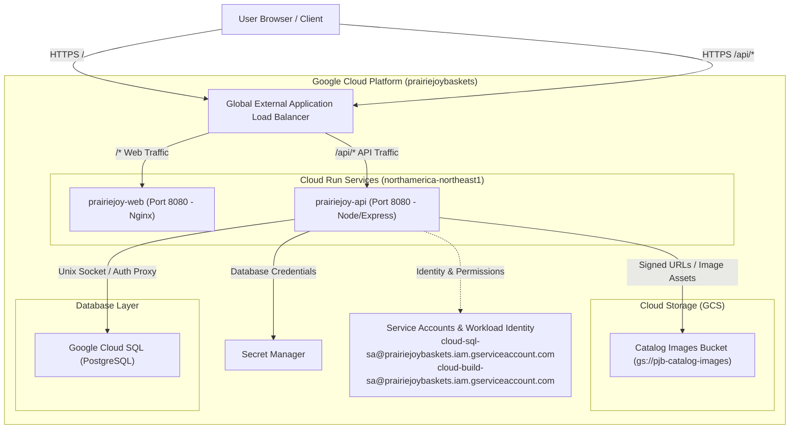

# Prairie Joy Baskets (PJB_app) — Architecture & Deployment Guide

**Author:** Daniel Gorelkin - Dgoralkin@Github  
**Description:** Prairie Joy Baskets app is a cloud-based full-stack (Cloud SQL Postgres based) monorepo application for a web and mobile B2B/B2C platform.

---

## 1. Executive Architecture Overview

Prairie Joy Baskets is structured as a modern full-stack monorepo separating client-side presentation from secure server-side cloud operations:



---

## 2. Monorepo Project Structure

```text
PJB_app/
├── package.json               # Root workspace configuration & scripts (pnpm + Turborepo)
├── pnpm-workspace.yaml        # pnpm workspace definition (apps/* and packages/*)
├── pnpm-lock.yaml             # Unified dependency lockfile for monorepo reproducibility
├── turbo.json                 # Turborepo task pipeline caching configuration
├── cloudbuild.yaml            # GCP Cloud Build multi-service CI/CD deployment pipeline
├── Dockerfile                 # Root multi-stage container file for web app (Nginx on Cloud Run)
├── PROJECT_ARCHITECTURE.md    # System architecture and deployment specification
│
├── apps/
│   ├── web/                   # Frontend SPA (React + Vite + TypeScript)
│   │   ├── index.html         # HTML entry point
│   │   ├── vite.config.ts     # Vite bundler configuration & local API proxy settings
│   │   ├── tailwind.config.js # Configuration file for Tailwind CSS framework
│   │   ├── postcss.config.js  # PostCSS configuration
│   │   ├── package.json       # Frontend dependencies (consumes @repo/types, @repo/api-client)
│   │   └── src/
│   │       ├── main.tsx       # React DOM root mounting
│   │       ├── App.tsx        # Top-level routing, layout & UI composition
│   │       ├── css.d.ts       # CSS declarations for Tailwind
│   │       └── pages/         # Page views (Catalog, Custom Basket, Checkout)
│   │
│   ├── api/                   # Backend Service (Node.js + Express + TypeScript)
│   │   ├── .env               # Local environment variables (gitignored)
│   │   ├── package.json       # Backend dependencies (@google-cloud/storage, pg, express)
│   │   ├── Dockerfile         # Standalone multi-stage container for backend Cloud Run
│   │   ├── tsconfig.json      # Backend TypeScript configuration extending @repo/tsconfig
│   │   └── src/
│   │       ├── index.ts       # Server entry point, middleware, routes & Cloud Storage integration
│   │       └── db.ts          # Cloud SQL PostgreSQL connection pool
│   │
│   └── mobile/                # Mobile client application placeholder (.gitkeep)
│
└── packages/                  # Shared internal workspace libraries
    ├── types/                 # Shared TypeScript models and interfaces (@repo/types)
    │   ├── package.json       # Package manifest exporting ./src/index.ts
    │   ├── tsconfig.json      # TypeScript configuration extending @repo/tsconfig
    │   └── src/
    │       └── index.ts       # Domain models (Category, Basket, CartItem, Addon, Zone)
    │
    ├── api-client/            # Shared typed API client library (@repo/api-client)
    │   ├── package.json       # Package manifest consuming @repo/types
    │   ├── tsconfig.json      # TypeScript configuration extending @repo/tsconfig
    │   └── src/
    │       └── index.ts       # PrairieJoyClient SDK for /api/v1/categories and /api/v1/baskets
    │
    └── tsconfig/              # Shared base compiler configurations (@repo/tsconfig)
        ├── package.json       # Package manifest
        └── base.json          # Shared tsconfig base compiler options
```

### Detailed Structure & Configuration Breakdown

#### 2.1 Root Dockerfile (`Dockerfile`)
- **Purpose:** Multi-stage container definition specifically packaging `apps/web` for production execution on Google Cloud Run.
- **Stage 1 (Builder):** Uses `node:22-alpine` with `pnpm@12.6.0`, installs workspace dependencies using `--frozen-lockfile`, copies shared workspace packages (`packages/types`, `packages/api-client`, `packages/tsconfig`), and runs `pnpm --filter web build`.
- **Stage 2 (Production Server):** Uses a hardened `nginx:alpine` image, copies the static production output from `/app/apps/web/dist` to `/usr/share/nginx/html`, patches port configuration to listen on `8080` (Cloud Run requirement), and serves the frontend over Nginx.

#### 2.2 Cloud Build Configuration (`cloudbuild.yaml`)
- **Automated CI/CD:** Orchestrates container builds and deployments on Google Cloud Run without requiring downloaded service account keys.
- **Service Account Identity:** Runs under `cloud-build-sa@prairiejoybaskets.iam.gserviceaccount.com`.
- **Artifact Registry Repository:** Pushes versioned Docker images to:
  - `northamerica-northeast1-docker.pkg.dev/prairiejoybaskets/pjb-arti-repo/prairiejoy-api:$COMMIT_SHA`
  - `northamerica-northeast1-docker.pkg.dev/prairiejoybaskets/pjb-arti-repo/prairiejoy-web:$COMMIT_SHA`
- **Cloud Run Deployment Steps:**
  - Deploys `prairiejoy-api` using `apps/api/Dockerfile` on port `8080` in `northamerica-northeast1`.
  - Deploys `prairiejoy-web` using root `Dockerfile` on port `8080` in `northamerica-northeast1`.
  - Shifts 100% of traffic to the latest deployed revision (`--to-latest`).

#### 2.3 pnpm Workspace Files (`pnpm-workspace.yaml` & `pnpm-lock.yaml`)
- **Workspace Resolution:** Declares `apps/*` and `packages/*` as first-class monorepo members, enabling instant cross-package resolution (e.g., `workspace:*`).
- **Security & Overrides:** Manages package-level overrides for core dependencies (e.g., `esbuild`, `vite`, `postcss-selector-parser`, `source-map-js`).
- **Reproducibility:** `pnpm-lock.yaml` provides deterministic, tamper-proof dependency graphs across local development, Docker multi-stage builds, and Cloud Build pipelines.

#### 2.4 Shared Packages Directory (`packages/`)
- **`@repo/types` (`packages/types`):**
  - Acts as the central data contract between `apps/api`, `apps/web`, and `@repo/api-client`.
  - Exports core business domain interfaces:
    - `Category`: Unique id, category name, sort order.
    - `Basket`: Comprehensive catalog basket schema (title, category, pricing, ratings, reviews, image URL, descriptions, tags, contents, active status).
    - `CartItem`: Shopping cart item state derived from `Basket` with quantity and customization support.
    - `Addon` & `Zone`: Delivery zones, pricing, estimated transit days, and basket add-ons.
- **`@repo/api-client` (`packages/api-client`):**
  - Strongly-typed client SDK (`PrairieJoyClient`) consumed by `apps/web`.
  - Standardizes REST requests to the backend:
    - `getCategories()`: Fetches list of categories (`/api/v1/categories`).
    - `getBaskets(category?)`: Fetches catalog baskets filtered by category (`/api/v1/baskets`).
- **`@repo/tsconfig` (`packages/tsconfig`):**
  - Provides `base.json` with standardized TypeScript compiler rules (ES2022 target, strict type safety, declaration generation) extended by both apps and libraries.

---

## 3. GCP Cloud Infrastructure & Load Balancer

### 3.1 Global External Application Load Balancer (HTTPS)

A single static external IP address fronts the entire platform with Google-managed SSL certificates:

- **Host and Path Routing (URL Map):**
  - `/*` (Default Route): Directs to the `prairiejoy-web` Cloud Run service (or Backend Bucket with Cloud CDN).
  - `/api/*`: Directs to the `prairiejoy-api` Cloud Run service via Serverless Network Endpoint Group (Serverless NEG).
- **CORS Elimination:** Because both frontend and backend share the exact same domain origin (e.g., `https://prairiejoybaskets.ca` and `https://prairiejoybaskets.ca/api/`), cross-origin resource sharing (CORS) complications are eliminated in production.

### 3.2 Database & Storage Configuration

#### Cloud SQL (Items Catalogue)
- **Engine:** PostgreSQL.
- **Connection in Cloud Run:** Attached via native Cloud Run integration. Accessible over the internal Unix socket at `/cloudsql/<PROJECT_ID>:<REGION>:<INSTANCE_NAME>` without exposing the database to the public internet.
- **Connection from Localhost:** Run the Cloud SQL Auth Proxy on your local machine:
  ```powershell
  cloud-sql-proxy prairiejoybaskets:<REGION>:<INSTANCE_NAME> --port 5432
  ```

#### Cloud Storage (Catalog Images)
- **Bucket Configuration:** Unified storage bucket for item images (`gs://pjb-catalog-images`).
- **Access Pattern:** The backend generates time-limited signed URLs or serves public CDN-cached image URLs, authenticated using the service account `cloud-sql-sa@prairiejoybaskets.iam.gserviceaccount.com`.

### 3.3 Identity & Security Architecture
- **Zero Long-Lived Service Account Keys:**
  - **Production:** Cloud Run automatically assumes the identity of `cloud-sql-sa@prairiejoybaskets.iam.gserviceaccount.com` through Cloud Run runtime service account bindings.
  - **Local Development:** Uses Workload Identity Federation or Google Application Default Credentials (ADC) impersonation:
    ```powershell
    gcloud auth application-default login --impersonate-service-account=cloud-sql-sa@prairiejoybaskets.iam.gserviceaccount.com
    ```
- **Secrets Management:** Database passwords and sensitive tokens are injected into Cloud Run directly via Google Cloud Secret Manager.

---

## 4. CI/CD Deployment Pipeline

### Deployment Pipeline Stages (via Cloud Build)

1. **Continuous Integration (CI):**
   - Workspace dependency validation via `pnpm install --frozen-lockfile`.
   - TypeScript compilation checks: `tsc --noEmit`.
2. **Backend Deployment (`prairiejoy-api`):**
   - Multi-stage Docker build via `apps/api/Dockerfile`.
   - Pushes image to Artifact Registry:
     `northamerica-northeast1-docker.pkg.dev/prairiejoybaskets/pjb-arti-repo/prairiejoy-api:$COMMIT_SHA`
   - Executes zero-downtime rolling update on Cloud Run with Cloud SQL connector enabled on port `8080`.
3. **Frontend Deployment (`prairiejoy-web`):**
   - Multi-stage Docker build via root `Dockerfile` (Vite build + Nginx Alpine).
   - Pushes image to Artifact Registry:
     `northamerica-northeast1-docker.pkg.dev/prairiejoybaskets/pjb-arti-repo/prairiejoy-web:$COMMIT_SHA`
   - Deploys to Cloud Run on port `8080`.
4. **Traffic Migration:**
   - Automatically migrates 100% of live traffic to the latest revisions across both services.
